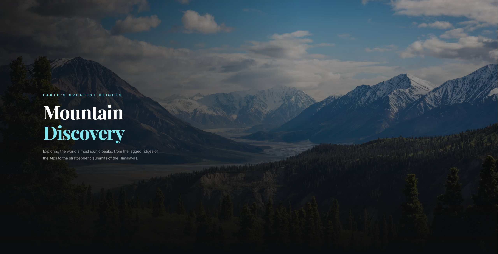

# 🏔️ Mountain Discovery

A mountain exploration landing page showcasing iconic peaks from around the world. It was built as a school project during Grade 8 and later refactored from Bootstrap to Tailwind CSS in Grade 9, then uploaded to GitHub on August.

### Featured Peaks
1. **The Matterhorn** - Switzerland/Italy border
2. **Mount Everest** - Nepal/China border
3. **Mount Fuji** - Japan

### Peaks of the Month
1. **Aconcagua** - South America (6,961m)
2. **Denali** - North America (6,190m)
3. **Kilimanjaro** - Africa (5,895m)
4. **Mount Elbrus** - Europe (5,642m)
